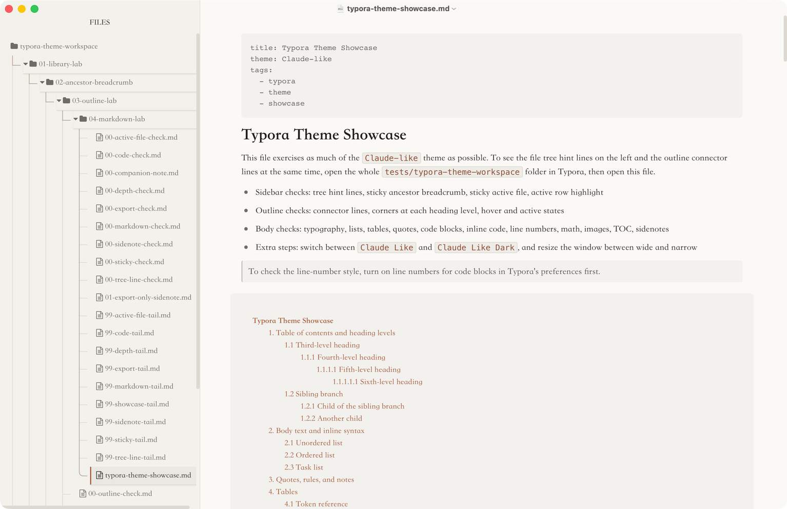
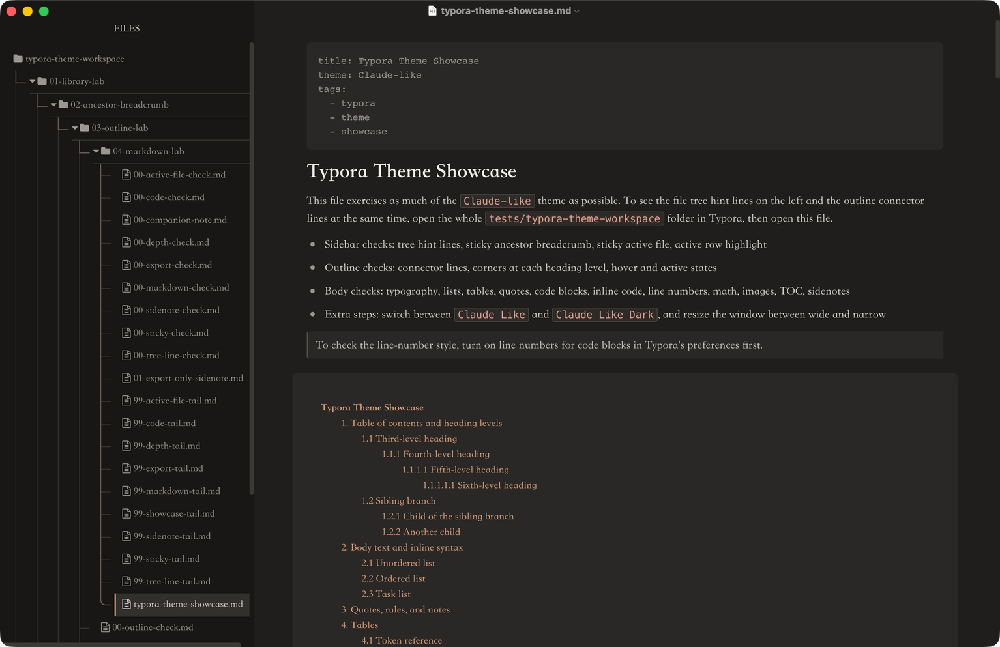
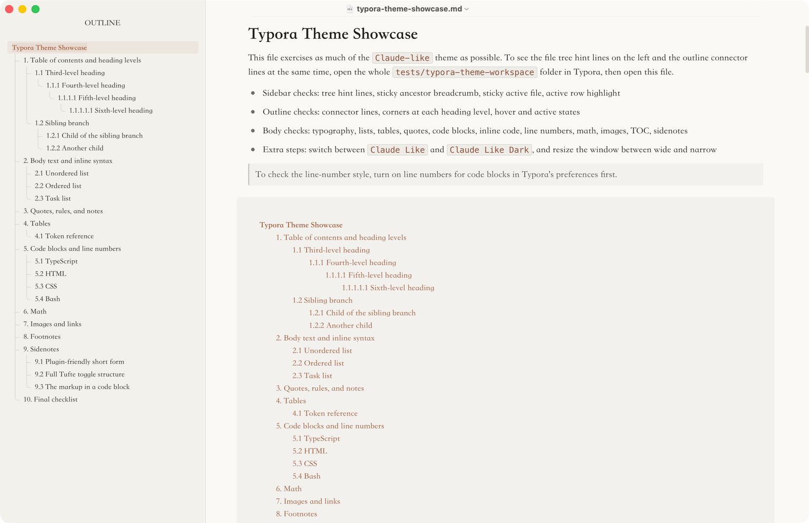
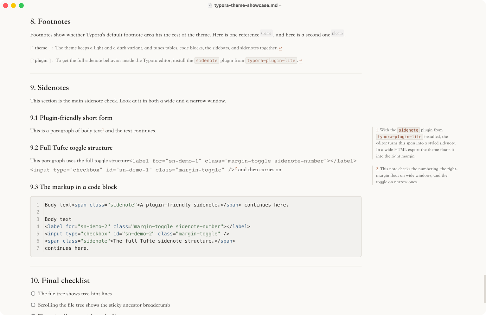
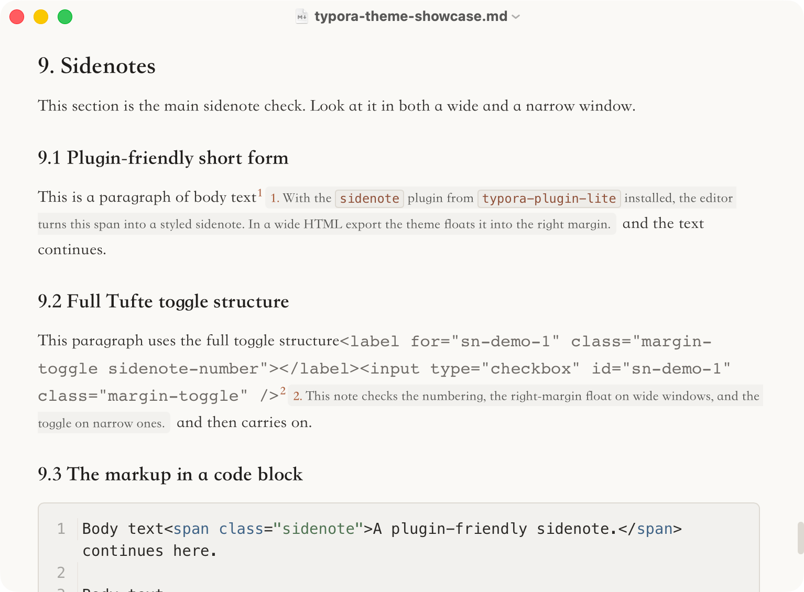

# Claude-Like Theme

[中文说明](README.zh.md) · Twin project [typora-plugin-lite](https://github.com/lr00rl/typora-plugin-lite): installs and syncs this theme, and provides the editor-side sidenotes, writing widths, file tree guides, and code fence features the theme is built to style. See [Working with typora-plugin-lite](#working-with-typora-plugin-lite).





A Typora theme modeled on a Claude-like reading experience: warm paper backgrounds, neutral structure, and a single accent color, tuned for long-form writing and technical notes in Chinese and English.

## Overview

The goal is not a pixel copy of a web page. The theme brings a quiet, restrained reading atmosphere into Typora and then carries it through the parts of Typora people use every day: body text, tables, code blocks, the file tree, the outline, sidenotes, and exported HTML and PDF.

The repository contains:

- `claude-like.css`: the light theme (generated from `src/`; this is the file Typora loads)
- `claude-like-dark.css`: the dark theme
- `theme-pack.json`: the bootloader read by the `theme-pack` plugin in `typora-plugin-lite` (`typ` / `version` / `files`)
- `src/`: the light and dark tokens plus the shared rules. Edit here, then run `node scripts/build.mjs`
- `tests/`: the theme contract test and a Typora demo workspace for checking the sidebar, outline, Markdown, and sidenotes

## Features

- File tree hint lines: vertical stems, horizontal connectors, and a rounded corner on the last child
- A sticky active file and sticky ancestor folders in the File Library, up to 10 nested levels
- Connector lines in the Outline sidebar, with hover and active states
- GitHub-style alerts (`[!NOTE]`, `[!TIP]`, `[!IMPORTANT]`, `[!WARNING]`, `[!CAUTION]`), each with its own muted color
- Code blocks with a language label, syntax colors, and line numbers drawn with CSS counters
- An 860px writing column when no width plugin is installed, images that keep their aspect ratio, and softer styling for checked tasks
- Tufte-style sidenotes, plus editor-side styling when used with the `sidenote` plugin from `typora-plugin-lite`
- Light and dark variants assembled from one shared stylesheet, with body text held to at least 7:1 contrast and muted and accent text to at least 4.5:1 by the test suite

## Installation

Install [typora-plugin-lite](https://github.com/lr00rl/typora-plugin-lite). The installer writes both CSS files into Typora's theme folder, so the Themes menu lists them on the first launch after install. It does not switch you off the theme you already use, and Typora's built-in themes such as GitHub and Newsprint stay available. The repo-root `theme-pack.json` is the bootloader the plugin reads.

You can also copy the files by hand, or download them from [GitHub Releases](https://github.com/lr00rl/typora-claude-like-theme/releases):

1. Open Typora.
2. Go to `Preferences -> Appearance -> Open Theme Folder`.
3. Copy these files into the theme folder:
   - `claude-like.css`
   - `claude-like-dark.css`
4. Restart Typora.
5. Pick one of these entries from the Themes menu:
   - `Claude Like`
   - `Claude Like Dark`

> On Windows, set `Preferences -> Appearance -> Window Style` to `Unibody` and restart Typora. The theme is more stable in that mode.

## Working with typora-plugin-lite

[typora-plugin-lite](https://github.com/lr00rl/typora-plugin-lite) is the Typora plugin system maintained alongside this theme. The theme owns appearance and the plugins own editor behavior. They meet at class names and CSS variables, and neither changes the other's implementation.

| Plugin | Relationship to the theme |
| --- | --- |
| [`theme-pack`](https://github.com/lr00rl/typora-plugin-lite#theme-pack) | The installer writes both CSS files into Typora's theme folder, and on startup the plugin syncs them from this repo through `theme-pack.json`. It never switches your current theme. |
| [`sidenote`](https://github.com/lr00rl/typora-plugin-lite/blob/main/plugins/sidenote/README.md) | Detects `<span class="sidenote">` in the editor and adds CSS-targetable classes. The theme lays out margin notes from the `--tpl-sidenote-*` variables. |
| [`wider`](https://github.com/lr00rl/typora-plugin-lite/blob/main/plugins/wider/README.md) | Owns the Default / Wide / Full width of `#write`. Without the plugin the theme falls back to an 860px body. |
| [`fence-enhance`](https://github.com/lr00rl/typora-plugin-lite/tree/main/plugins/fence-enhance) | Eager fence rendering and copy buttons, plus `--tpl-lineno-digits`, which the theme uses to size the line-number gutter to each block. Without the plugin the gutter reserves four digits. |
| [`tree-guides`](https://github.com/lr00rl/typora-plugin-lite/tree/main/plugins/tree-guides) | Draws the file tree guides as one stroke per folder and lights the branch that holds the open file. While it runs, the theme's own CSS connectors step aside. |

The plugins' own panels, such as the Plugin Center and Quick Open, read the theme's `--tpl-ui-*` tokens, so they take the theme's surfaces, text colors, accent, and fonts in both variants.

The screenshots in this README were taken in Typora with typora-plugin-lite installed.

## Design priorities

- A CJK serif body stack (Songti SC first) that keeps Chinese and mixed Chinese and English text steady, with separate font roles for headings, UI, and code
- Calm long-form reading: low saturation, soft contrast, and generous spacing that stays out of the way of the text
- Practical technical writing: tables, code blocks, inline code, math, and export output share one visual language
- Light and dark maintained as separately tuned token sets, not simple inversions: contrast, border strength, and code colors are set for each

## Visual highlights

### 1. File tree and outline

- Tree connector lines in the File Library
- A clearer active-file highlight with a left accent bar
- Ancestor folders of the active file stick to the top one by one as the tree scrolls
- Matching connector lines and corners in the Outline sidebar



### 2. Body text and Markdown

- Steady rhythm for Chinese and mixed Chinese and English text
- A clear heading hierarchy down to the sixth level
- Consistent styling for blockquotes, alerts, horizontal rules, lists, and task lists
- A dedicated container style for the `[TOC]` block

### 3. Tables and code

- Unified table borders, row spacing, numeric alignment, and row hover states
- Inline code as a quiet capsule
- Fenced code blocks with their own background, border, language label, and syntax highlighting
- When line numbers are turned on in Typora, the theme draws them in its own colors and keeps them out of text selection

### 4. Sidenotes

The theme ships Tufte-style sidenote rules for definitions, asides, and margin notes.

Minimal usage:

```html
Body text<span class="sidenote">This is a sidenote.</span> body continues.
```

For numbered sidenotes inside the Typora editor, use the `sidenote` plugin from [typora-plugin-lite](https://github.com/lr00rl/typora-plugin-lite). The plugin finds the inline HTML marker and adds the classes the theme styles. In the editor, the plugin moves notes into the margin only when the 860px writing column and a 300px margin both fit, and keeps them inline otherwise. In exported HTML and PDF, the theme floats notes into the right margin when the page is at least 1200px wide. Below that, plain sidenote spans stay inline, and notes written with the full Tufte toggle structure fold behind their number and open when it is clicked.

Wide window:



Narrow window:



## Demo workspace

The repository includes a Typora workspace for checking the theme by hand:

- Root folder: `tests/typora-theme-workspace`
- Main showcase file: `tests/typora-theme-workspace/01-library-lab/02-ancestor-breadcrumb/03-outline-lab/04-markdown-lab/typora-theme-showcase.md`

Recommended steps:

1. Open the whole `tests/typora-theme-workspace` folder in Typora.
2. Keep the File Library and the Outline visible.
3. Open the deep `typora-theme-showcase.md` file.
4. Scroll the file tree to check the tree hint lines, the sticky ancestor breadcrumb, and the sticky active file.
5. In the document, check the heading hierarchy, TOC, alerts, tables, code blocks, code line numbers, math, images, footnotes, and sidenotes.
6. Switch between `Claude Like` and `Claude Like Dark`, then resize the window to compare sidenotes in a wide and a narrow layout.

## Building and testing

The two published stylesheets are generated. Edit `src/tokens-light.css`, `src/tokens-dark.css`, or `src/shared.css`, then rebuild and run the tests:

```bash
node scripts/build.mjs
node --test tests/theme-contract.test.mjs
```

The contract test checks the semantic and plugin tokens, the contrast floors, the shared structure of the light and dark files, and that the published CSS matches what `src/` assembles.

Pushing a `v*` tag runs `.github/workflows/release-latest.yml`, which builds, tests, and publishes both CSS files and a zip to GitHub Releases. Release notes come from `releases/`; see [releases/README.md](releases/README.md) for the lookup order.

## Best use cases

- Long Markdown documents
- Cleaning up and rewriting AI conversations
- Technical notes in Chinese, English, or both
- Documentation with many tables and fenced code blocks
- Documents that need to export cleanly to PDF

## Files

- `src/tokens-light.css` / `src/tokens-dark.css`: light and dark color tokens
- `src/shared.css`: structural rules shared by both themes
- `claude-like.css` / `claude-like-dark.css`: the Typora files, assembled by `node scripts/build.mjs`
- `README.md`: English documentation
- `README.zh.md`: Chinese documentation
- `image/`: README screenshots (`image/zh/` holds the ones used by the Chinese README)
- `tests/theme-contract.test.mjs`: the theme contract test
- `tests/typora-theme-workspace`: the demo workspace

## Origin and license

This theme started as a fork of [Muyiiiii/Typora_Claude-Like_Theme](https://github.com/Muyiiiii/Typora_Claude-Like_Theme). After substantial rework of the file tree, outline, sidenotes, build pipeline, and plugin integration, it is now maintained as an independent repository. It stays under the MIT License, and the original author's copyright notice is kept in [LICENSE](LICENSE).
